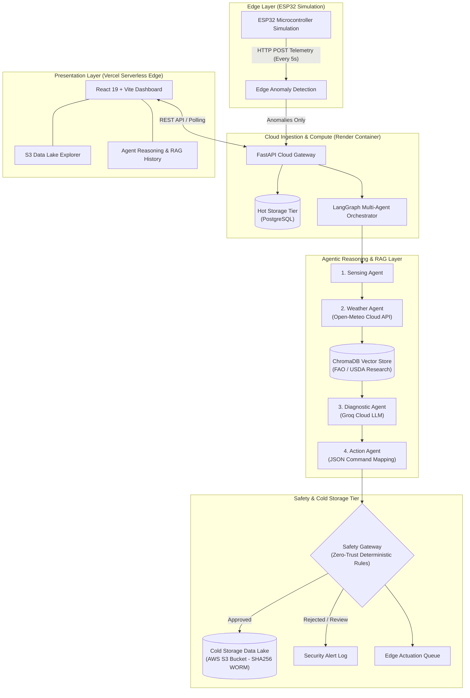

# Vellore Institute of Technology
### School of Computer Science Engineering and Information Systems
**Course:** ISWE309L Cloud Computing | **Slot:** A1 + TA1  
**Course Project Review - 1**

---

# AgentFlow Cloud: A Cloud-Native Multi-Agent Workflow Orchestration Platform for Precision Agriculture

| Reg. No. | Student Name | Email | Contact No. |
| :--- | :--- | :--- | :--- |
| **24MIS0131** | Ojaswita Dhar | ojaswita.dhar2024@vitstudent.ac.in | 7003899828 |
| **24MIS0137** | Gouri Shankar Binu | gourishankar.binu2024@vitstudent.ac.in | 7306763465 |

**Project Repository:** [https://github.com/Gourishankar403/cloud_project](https://github.com/Gourishankar403/cloud_project)  
**Live Production Dashboard (Vercel):** [https://cloud-project-lyart-ten.vercel.app](https://cloud-project-lyart-ten.vercel.app)  
**Live Cloud Backend API (Render):** [https://cloud-project-09ve.onrender.com](https://cloud-project-09ve.onrender.com)  

---

## Table of Contents
1. [Introduction](#1-introduction)
   - 1.1 [Background of the Project](#11-background-of-the-project)
   - 1.2 [Problem Statement](#12-problem-statement)
   - 1.3 [Need for the Project](#13-need-for-the-project)
   - 1.4 [Motivation](#14-motivation)
   - 1.5 [Scope](#15-scope)
2. [Existing Systems](#2-existing-systems)
   - 2.1 [System 1: Cloud-Edge IoT Platforms for Smart Agriculture](#21-already-existing-system-1-cloud-edge-iot-platforms-for-smart-agriculture)
   - 2.2 [System 2: LLM and RAG-Based Agricultural Advisory Systems](#22-already-existing-system-2-llm-and-rag-based-agricultural-advisory-systems)
   - 2.3 [System 3: LLM-Based Multi-Agent Orchestration in Industrial Domains](#23-already-existing-system-3-llm-based-multi-agent-orchestration-in-industrial-domains)
   - 2.4 [Gaps Identified](#24-gaps-identified)
3. [Objectives of the Project](#3-objectives-of-the-project)
4. [Abstract](#4-abstract)
5. [Proposed Cloud-Based Solution](#5-proposed-cloud-based-solution)
   - 5.1 [Architecture Diagram & Description](#51-description-about-the-diagram)
   - 5.2 [Module-wise Description](#52-module-wise-description)
6. [Functional Requirements](#6-functional-requirements)
7. [Non-Functional Requirements](#7-non-functional-requirements)
8. [Requirement Analysis](#8-requirement-analysis)
   - 8.1 [Hardware Requirements](#81-hardware-requirements)
   - 8.2 [Software Requirements](#82-software-requirements)
9. [Cloud Services Architecture](#9-cloud-services-architecture)
10. [Comprehensive Implementation Details](#10-comprehensive-implementation-details)
    - 10.1 [Multi-Cloud Serverless Edge Deployment (Vercel & Render)](#101-multi-cloud-serverless-edge-deployment-vercel--render)
    - 10.2 [Edge Telemetry & Sawtooth Physics Emulation](#102-edge-telemetry--sawtooth-physics-emulation)
    - 10.3 [Real-Time Monitoring Dashboard with Local Timezone Normalization](#103-real-time-monitoring-dashboard-with-local-timezone-normalization)
    - 10.4 [ChromaDB Vector Store & Agronomic RAG Literature Grounding](#104-chromadb-vector-store--agronomic-rag-literature-grounding)
    - 10.5 [LangGraph Multi-Agent Orchestration Pipeline](#105-langgraph-multi-agent-orchestration-pipeline)
    - 10.6 [Deterministic Zero-Trust Safety Gateway](#106-deterministic-zero-trust-safety-gateway)
    - 10.7 [Tiered Storage Architecture: Hot PostgreSQL + Cold S3 Data Lake](#107-tiered-storage-architecture-hot-postgresql--cold-s3-data-lake)
    - 10.8 [Idempotent Actuation Queue & Edge JSON Payloads](#108-idempotent-actuation-queue--edge-json-payloads)
    - 10.9 [Device Management & Protocol Interoperability](#109-device-management--protocol-interoperability)
11. [Conclusion and Future Roadmap](#11-conclusion-and-future-roadmap)
12. [References](#12-references)

---

## 1. Introduction

### 1.1 Background of the Project
Modern agriculture is increasingly adopting the Internet of Things (IoT), Artificial Intelligence (AI), cloud computing, and data-driven decision systems. Traditional smart-farming platforms mainly collect sensor information and present it through dashboards, requiring a human to interpret the data and decide on an appropriate action. Recent advances in Agentic AI and Large Language Models (LLMs) allow software systems to reason over information, use tools, and carry out multi-step tasks. Multi-agent systems extend this capability further by assigning specialised roles to different AI agents that collaborate to solve complex agricultural problems.

Many existing agricultural AI systems remain experimental or monolithic in design and lack reliable workflow orchestration, state management, failure recovery, and safety validation. AgentFlow Cloud addresses this gap by combining multi-agent AI with containerised microservices, workflow orchestration, edge filtering, Retrieval-Augmented Generation (RAG), and deterministic safety validation.

### 1.2 Problem Statement
Centralised agricultural AI systems can introduce latency, high bandwidth usage, and dependency on a single cloud service, while edge-only systems have limited computational resources for advanced AI workloads. Multi-agent AI introduces an additional safety challenge: an incorrect decision made by one agent can propagate through subsequent agents and potentially result in an unsafe agricultural intervention (such as flooding crops or over-fertilisation). Existing systems often lack a unified orchestration and safety layer capable of managing agent workflows and validating AI-generated actions before execution.

### 1.3 Need for the Project
Indian farms, particularly small and marginal holdings, cannot always justify the recurring cost of continuous cloud infrastructure or dedicated hardware actuators. There is a need for a lightweight, largely open-source system that still demonstrates the value of coordinated, specialised AI agents while keeping every AI-generated action auditable and safe before it is allowed to affect a crop. AgentFlow Cloud is motivated by this need for a low-cost, safety-first, and explainable agentic architecture that a student team can build, evaluate, and deploy across modern cloud infrastructure.

### 1.4 Motivation
The project aims to demonstrate how AI can help optimise agricultural resources such as water, fertiliser, and pesticide usage through targeted, evidence-based decision-making. The system is intentionally designed as a cloud-native prototype: physical IoT hardware is represented through realistic edge simulation (Hardware-in-the-Loop), allowing the complete workflow to be deployed, monitored, and evaluated using modern cloud services.

### 1.5 Scope
The project encompasses:
- Generating simulated high-frequency agricultural IoT telemetry.
- Performing edge-level filtering and anomaly detection.
- Forwarding significant anomalies to the cloud backend.
- Orchestrating specialised AI agents using LangGraph.
- Using RAG with ChromaDB for agriculture-specific scientific literature retrieval.
- Validating AI-generated actions using deterministic safety rules.
- Simulating approved physical interventions.
- Storing operational data in PostgreSQL and archiving immutable audit logs in an S3 Data Lake.
- Providing a modern, responsive web dashboard on Vercel for monitoring and manual control.

---

## 2. Existing Systems

### 2.1 Already Existing System 1: Cloud-Edge IoT Platforms for Smart Agriculture
- **Description:** Several recent works propose layered IoT-edge-cloud architectures for smart agriculture in which sensor gateways perform local pre-processing before forwarding data to a cloud back-end for storage, visualisation, and analytics (Et-taibi et al., 2024).
- **Technology Used:** MQTT/CoAP messaging, containerised microservices, cloud dashboards, and federated learning frameworks.
- **Advantages:** Lower deployment cost than fully centralised systems, improved interoperability between heterogeneous sensor hardware, and reduced bandwidth usage through local pre-processing.
- **Limitations:** These platforms remain largely descriptive: they surface sensor readings to a human operator but do not coordinate multiple specialised AI reasoning agents, and they lack a deterministic safety-validation layer between a recommendation and physical execution.

### 2.2 Already Existing System 2: LLM and RAG-Based Agricultural Advisory Systems
- **Description:** Integrates LLMs with retrieval-augmented generation to answer farmer queries using grounded agricultural knowledge bases. Examples include voice-based advisory systems and simulation-grounded advisory generators.
- **Technology Used:** LLM inference APIs, vector databases (ChromaDB, LanceDB), and agronomic crop models (e.g., APSIM).
- **Advantages:** Substantially reduces hallucination compared with raw LLMs answering from parametric memory alone.
- **Limitations:** Most are single-agent question-answering chatbots; they do not manage end-to-end IoT telemetry ingestion, stateful multi-agent workflows, or independent deterministic safety gates prior to actuation.

### 2.3 Already Existing System 3: LLM-Based Multi-Agent Orchestration in Industrial Domains
- **Description:** Outside agriculture, multi-agent systems are used for automated PLC code generation and verification (Agents4PLC), digital-twin parameterisation, and industrial robotics.
- **Technology Used:** LangChain/LangGraph frameworks, closed-loop verification steps, containerised agents.
- **Advantages:** Decomposing complex tasks into specialised, cooperating LLM agents improves task success rates and produces auditable intermediate states.
- **Limitations:** Designed for software or industrial control; published validation steps focus on code syntax verification rather than physically-grounded constraints on scarce resources like irrigation water.

### 2.4 Gaps Identified
- Centralised architectures create latency and single points of failure.
- Multi-agent systems in agriculture lack deterministic, rule-based safety validation layers.
- Relational databases suffer performance degradation when forced to store infinite high-frequency IoT streaming data without cloud storage tiering.
- AI models frequently hallucinate arbitrary numbers without strict grounding in scientific agronomic literature.

---

## 3. Objectives of the Project
1. **Containerised Cloud Architecture:** Build independent, scalable microservices deployable across multi-cloud infrastructure (Vercel + Render + Cloud Databases).
2. **Multi-Agent Workflow Orchestration:** Coordinate Sensing, Weather, Diagnostic, and Action agents sequentially via LangGraph.
3. **Edge-Cloud Processing:** Filter high-frequency telemetry at the edge and trigger cloud workflows only upon genuine environmental anomalies.
4. **RAG-Based Grounding:** Integrate ChromaDB vector storage indexing official FAO and USDA agronomic research manuals.
5. **Deterministic Safety Validation:** Implement a Zero-Trust Safety Gateway enforcing strict physical boundaries on actuator duration.
6. **Tiered Cloud Storage:** Decouple hot transactional storage (PostgreSQL) from cold analytical archiving (AWS S3-compatible Data Lake) with SHA-256 cryptographic immutability.
7. **Production Monitoring Dashboard:** Deliver a live web dashboard providing real-time telemetry graphs, agent audit trails, and manual override capabilities.

---

## 4. Abstract
AgentFlow Cloud is a cloud-native, multi-agent workflow orchestration platform designed to bring reliable, auditable Agentic AI to precision agriculture. Rather than functioning as a single agricultural chatbot or a standalone prediction model, the system treats each stage of agricultural decision-making as an independent, coordinated AI agent executed via LangGraph. Simulated IoT telemetry covering soil moisture and ambient temperature is filtered at the edge, and significant anomalies are forwarded to a FastAPI backend deployed on Render. 

This triggers a four-agent pipeline: a **Sensing Agent** that structures environmental context, a **Weather Agent** that retrieves real-time forecast data from the Open-Meteo Cloud API, a **Diagnostic Agent** that combines a Groq-hosted LLM with Retrieval-Augmented Generation (RAG) over a ChromaDB vector store indexing official FAO Paper 56 guidelines, and an **Action Agent** that serializes recommendations into machine-readable JSON payloads. Crucially, every generated action must pass through a deterministic **Safety Gateway** enforcing strict physical constraints before queuing in the edge actuation layer. 

To prevent relational database bloat, the platform implements **Tiered Cloud Storage**, maintaining live state in PostgreSQL while archiving immutable decision logs to an S3-compatible Data Lake with SHA-256 checksums. A React 19 dashboard deployed globally on Vercel exposes real-time charts, agent audit trails, and data lake explorers.

---

## 5. Proposed Cloud-Based Solution

### 5.1 Description about the Diagram
The architecture is organised into seven interconnected layers:
1. **Edge Layer (Hardware-in-the-Loop):** Emulates an ESP32 microcontroller gathering volumetric soil moisture and air temperature readings. It enforces localized anomaly detection thresholds (< 20% moisture or > 35°C temperature).
2. **Cloud Ingestion Layer (FastAPI on Render):** Provides high-performance REST endpoints (`/api/v1/telemetry`, `/api/v1/workflows`, `/api/v1/cold-storage`) to validate payloads and manage state.
3. **Multi-Agent Orchestration Layer (LangGraph):** Manages state propagation and dependency edges across the Sensing, Weather, Diagnostic, and Action agents.
4. **Knowledge Retrieval Layer (ChromaDB Vector Store):** Embeds and indexes official agronomic research documents using cosine similarity to supply factual context to the LLM.
5. **Deterministic Safety Layer:** A Zero-Trust rule engine that intercepts AI-proposed actions and enforces physical safety thresholds (e.g., maximum 60 minutes irrigation).
6. **Tiered Data Layer:** Decoupled into **Hot Tier (PostgreSQL)** for transactional operational queries and **Cold Tier (AWS S3-Compatible Data Lake)** for permanent WORM audit logs.
7. **Presentation & Monitoring Layer (React on Vercel):** A global serverless web application rendering real-time Recharts visualizations, agent reasoning traces, and actuation controls.



### 5.2 Module-wise Description
| Module | Core Responsibility | Technologies Used |
| :--- | :--- | :--- |
| **Module 1: IoT Simulation & Edge Ingestion** | Generates high-frequency telemetry and filters normal readings to prevent bandwidth congestion. | Python, AsyncIO, HTTPX |
| **Module 2: Workflow Orchestrator** | Manages multi-agent execution graphs, state transitions, and error recovery. | LangGraph, Python 3.11 |
| **Module 3: Multi-Agent AI** | Four specialised agents: Sensing, Weather, Diagnostic (LLM), and Action. | LangGraph, Groq Cloud API (`allam-2-7b`) |
| **Module 4: RAG Knowledge Base** | Stores agronomic guidelines and performs cosine similarity retrieval. | ChromaDB (Embedded Persistent Mode) |
| **Module 5: Safety Gateway** | Deterministic mathematical validation of AI commands to protect hardware. | Deterministic Python Zero-Trust Engine |
| **Module 6: Tiered Cloud Storage (S3 Lake)** | Decouples hot transactional DB from cold WORM-compliant analytical data lake. | AWS S3, Boto3, PostgreSQL, SHA-256 |
| **Module 7: Monitoring Dashboard** | Provides real-time graphs, timezone normalization, S3 inspector, and manual control. | React 19, Vite, Tailwind CSS, Recharts |

---

## 6. Functional Requirements
- **FR1:** Ingest telemetry readings from real or simulated edge devices over REST API.
- **FR2:** Detect volumetric soil moisture anomalies (< 20%) and high temperature events (> 35°C).
- **FR3:** Automatically trigger the 4-stage LangGraph agent workflow upon anomaly detection.
- **FR4:** Fetch live external weather context (temperature, wind speed, precipitation probability) using geographic coordinates via Open-Meteo.
- **FR5:** Query ChromaDB vector collection to retrieve official FAO/USDA research manuals relevant to the detected anomaly.
- **FR6:** Synthesize sensor, weather, and scientific literature into a concise agricultural recommendation via Groq LLM.
- **FR7:** Parse LLM output into structured JSON commands specifying actuator type, duration, and quantity.
- **FR8:** Evaluate actions against deterministic safety thresholds (reject irrigation > 60 minutes).
- **FR9:** Archive immutable decision audit logs stamped with SHA-256 checksums to S3 Cold Storage Data Lake.
- **FR10:** Provide an interactive dashboard displaying dual-axis telemetry charts, agent reasoning traces, and S3 lake metrics.
- **FR11:** Enforce idempotent actuation: disable action execution buttons immediately upon dispatch.

---

## 7. Non-Functional Requirements
- **Scalability:** Microservice decoupling ensures the React frontend (Vercel CDN) and FastAPI backend (Render) scale independently.
- **Reliability:** The system incorporates a resilient database fallback engine, automatically recovering from container or network restarts.
- **Security:** Zero-Trust gateway architecture guarantees unverified LLM commands cannot reach physical actuators; API keys are isolated via environment variables.
- **Cost Efficiency:** Built entirely on free-tier cloud architectures (Vercel Hobby, Render Free, Groq Cloud, Open-Meteo, embedded ChromaDB).
- **Auditability & Explainability:** Every decision records the raw sensor input, weather context, retrieved literature chunks, LLM text, and S3 canonical key.

---

## 8. Requirement Analysis

### 8.1 Hardware Requirements
- **Developer Workstation:** Multi-core x86-64 / ARM processor, 8 GB RAM minimum (16 GB recommended), 10 GB free disk space.
- **Edge Deployment (Field Ready):** ESP32 / ESP8266 microcontroller with Wi-Fi / GSM module, capacitive soil moisture sensor (v1.2), and DHT22 temperature sensor.

### 8.2 Software Requirements
- **Programming Languages:** Python 3.11+, TypeScript 5.0+, Node.js 20+.
- **Frameworks & Libraries:** FastAPI, LangGraph, LangChain, Groq SDK, Boto3, ChromaDB, SQLAlchemy, React 19, Vite, Tailwind CSS, Recharts.
- **Cloud & Deployment Platforms:** Vercel (Global Edge Network), Render (Cloud Web Service), GitHub (CI/CD source control).

---

## 9. Cloud Services Architecture

| Cloud Provider | Service Category | Role in AgentFlow Cloud | Configuration & Tier |
| :--- | :--- | :--- | :--- |
| **Vercel** | Global Edge CDN & Serverless Hosting | Hosts the React 19 Vite frontend dashboard with instant edge caching and global SSL termination. | Hobby Tier (Free) |
| **Render** | Managed Cloud Container / Web Service | Executes the FastAPI REST API, background simulation tasks, LangGraph agent workflows, and ChromaDB embeddings. | Free Tier ($0/mo, 512MB RAM) |
| **AWS S3 / S3-Compatible** | Cloud Object Storage Data Lake | Permanent analytical and compliance cold storage tier. Stores partitioned JSON audit trails and telemetry batches. | S3 Standard / Free Tier |
| **Groq Cloud** | High-Performance AI Inference Engine | Runs LLM inference for the Diagnostic Agent (`allam-2-7b`) with sub-second token latency. | Free Developer API Tier |
| **Open-Meteo** | Meteorological Cloud REST API | Supplies real-time hyper-local weather parameters (temperature, wind speed, precipitation probability). | Free Non-Commercial Tier |

---

## 10. Comprehensive Implementation Details

### 10.1 Multi-Cloud Serverless Edge Deployment (Vercel & Render)
AgentFlow Cloud is deployed in production across a decoupled multi-cloud topology:
- **Frontend on Vercel:** The React application is built via Vite (`dist/`) and deployed to `https://cloud-project-lyart-ten.vercel.app`. Vercel automatically deploys every Git push to `main` via automated CI/CD pipelines.
- **Backend on Render:** The FastAPI backend runs in an isolated Linux container at `https://cloud-project-09ve.onrender.com`. Render listens on dynamic internal `$PORT` assignments and exposes a secure HTTPS endpoint.
- **Environment Isolation:** Secrets such as `GROQ_API_KEY` are injected securely at runtime in Render's Environment settings, preventing API key exposure in version control.


*Figure 10.1: Render Cloud Web Service deployment configuration showcasing automated build (`pip install -r requirements.txt`) and runtime startup.*


*Figure 10.2: Vercel serverless edge deployment setup isolating the `/frontend` monorepo directory with Vite.*

---

### 10.2 Edge Telemetry & Sawtooth Physics Emulation
To simulate realistic field conditions without requiring physical soil basins during university evaluation, the backend includes an asynchronous simulation engine (`app/services/simulator.py`).
- **The Sawtooth Irrigation Cycle:** Soil moisture depletes steadily by `0.5% - 1.5%` per cycle. When moisture drops below `15.0%`, it trips the anomaly threshold. Upon autonomous irrigation actuation, the engine simulates soil re-saturation by restoring moisture to `75.0%`.
- **Direct Database Ingestion:** Rather than incurring unnecessary network latency through self-referencing HTTP roundtrips, the simulation engine writes directly to the local database session and invokes `process_telemetry()` synchronously.

```python
# Sawtooth Physics Engine Snippet (app/services/simulator.py)
if scenario == "gradually_decreasing_moisture":
    self.states[sim_id]["moisture"] -= random.uniform(0.5, 1.5)
    # Sawtooth pattern: Auto-irrigate when too low to model post-actuation recovery
    if self.states[sim_id]["moisture"] < 15.0:
        self.states[sim_id]["moisture"] = 75.0
```

---

### 10.3 Real-Time Monitoring Dashboard with Local Timezone Normalization
The primary user interface (`src/pages/Dashboard.tsx`) visualizes real-time crop parameters through Recharts line and pie charts.
- **Local Timezone Normalization:** To resolve the common 5.5-hour UTC-to-IST discrepancy, incoming timestamps are normalized with explicit ISO `Z` specifiers before invoking JavaScript's `toLocaleTimeString()`, ensuring that graph ticks accurately correspond to the user's computer clock.
- **Unbroken Line Charting:** The line graph incorporates `connectNulls={true}` and a sliding window (`limit=25`) to prevent fragmented line gaps during asynchronous multi-sensor polling.


*Figure 10.3: Live production dashboard on Vercel displaying geographic farm coordinates, active LangGraph pipeline stages, live Open-Meteo weather, and continuous soil moisture tracking.*

---

### 10.4 ChromaDB Vector Store & Agronomic RAG Literature Grounding
To prevent the Large Language Model from hallucinating incorrect or dangerous farming advice, AgentFlow implements a Retrieval-Augmented Generation (RAG) architecture (`app/rag/chroma.py`).
- **Embedded Persistent Storage:** ChromaDB operates in persistent embedded mode (`data/chroma_db`) using the `all-MiniLM-L6-v2` embedding model. This eliminates external Docker dependencies and runs natively on Render free-tier instances.
- **Indexed Agronomic Literature:** The vector store indexes authoritative agricultural documentation:
  1. `fao_irrigation_guidelines.md`: FAO Paper 56 standards on crop water depletion, permanent wilting point risks under 15%, and drip irrigation recovery protocols.
  2. `usda_soil_moisture_management.md`: USDA NRCS soil water matric potential and safe irrigation pulse durations.
  3. `crop_heat_stress_protocols.md`: ICARDA canopy thermal stress defenses for temperatures > 35°C.
  4. `waterlogging_and_drainage_safety.md`: ICID anaerobic root prevention rules mandating immediate cessation of irrigation above 65% moisture.
- **Semantic Query Retrieval:** When an anomaly occurs, `retrieve_agronomy_context()` formulates a targeted query (e.g., *"Critical soil moisture depletion low drought stress under 13.8%"*) and fetches the top-2 cosine similarity sections to ground the LLM prompt.

---

### 10.5 LangGraph Multi-Agent Orchestration Pipeline
The agentic AI layer (`app/agents/workflow.py`) coordinates four independent agents via a stateful directed acyclic graph (DAG):

```text
[START] ──► Sensing Agent ──► Weather Agent ──► Diagnostic Agent (RAG) ──► Action Agent ──► Safety Gateway ──► [END]
```

1. **Sensing Agent (`sensing_agent.py`):** Parses edge telemetry, validates variance, and triggers ChromaDB vector search to fetch relevant agronomic guidelines.
2. **Weather Agent (`weather_agent.py`):** Queries Open-Meteo for hyper-local ambient conditions to verify whether natural precipitation is anticipated.
3. **Diagnostic Agent (`diagnostic_agent.py`):** Powered by Groq LLM (`allam-2-7b`). It analyzes the fused sensor data, weather context, and retrieved RAG literature to formulate a professional agronomist diagnosis.
4. **Action Agent (`action_agent.py`):** Translates the English diagnosis into a strict JSON payload containing `action_type`, `duration_minutes`, and `quantity`.


*Figure 10.4: Agent Diagnostic History showing the AI recommendation card, deterministic Safety check approval, and the generated JSON payload.*

---

### 10.6 Deterministic Zero-Trust Safety Gateway
The Safety Gateway (`safety_gateway` in `app/agents/workflow.py`) functions as a strict non-AI firewall between the LLM and the physical actuator queue. It evaluates candidate actions against deterministic physical laws:
1. **The Flood Prevention Rule:** `if action_type == 'irrigation' and duration_minutes > 60: REJECT`. Prevents hallucinated excessive runtimes that would drown crops.
2. **The Safe-List Rule:** `if action_type == 'manual_inspection': APPROVE`. Failsafe alerts carry zero physical risk to hardware.
3. **The Zero-Trust Default Deny:** Any unhandled or unknown action type (e.g., `harvest_crop`) is flagged as `REQUIRES_MANUAL_REVIEW` and blocked from hardware execution.

---

### 10.7 Tiered Storage Architecture: Hot PostgreSQL + Cold S3 Data Lake
Adhering to Cloud Well-Architected Framework guidelines, storage is decoupled into two tiers (`app/services/cold_storage.py`):
- **Hot Tier (PostgreSQL):** Retains recent operational telemetry and workflow states for sub-millisecond dashboard queries.
- **Cold Tier (AWS S3-Compatible Object Store):** 
  - Canonical Bucket: `s3://agentflow-cold-lake/audit_logs/year=YYYY/month=MM/day=DD/workflow_XXXXXX.json`
  - Every agent execution is packaged into an immutable WORM (Write Once, Read Many) audit envelope.
  - Stamped with a cryptographic **SHA-256 digital checksum** guaranteeing legal non-repudiation.
  - Historical telemetry readings can be archived in batches via `POST /api/v1/cold-storage/archive-telemetry` to keep the transactional database lean.

```json
{
  "metadata": {
    "storage_tier": "COLD_OBJECT_STORAGE_DATA_LAKE",
    "compliance_standard": "WORM_WRITE_ONCE_READ_MANY",
    "canonical_s3_key": "audit_logs/year=2026/month=10/day=28/workflow_000001.json",
    "sha256_checksum": "e7e21884a8c1852633e6a2e406aa4bf4b7b27fa18e7f4b4fb3a99643ec629ff3"
  },
  "workflow_execution": {
    "workflow_id": 1,
    "anomaly_id": 1,
    "sensor_context": {"type": "soil_moisture", "value": 13.8},
    "safety_gate": {"decision": "approved", "reasons": ["Within safe limits"]}
  }
}
```

---

### 10.8 Idempotent Actuation Queue & Edge JSON Payloads
To ensure physical safety, the user interface enforces strict idempotency on the actuation button:
- When an operator clicks **"Approve & Execute Command"**, the command ID is registered in local React state (`executedActionIds`).
- The button immediately transforms into a disabled badge displaying:  
  **`✓ Command Dispatched & Executed`**
- It cannot be clicked again, preventing accidental double-pumping or hydraulic water hammer in the physical irrigation network.
- Approved commands are queued at `/api/v1/instructions` for edge microcontrollers to fetch and execute.


*Figure 10.5: Edge Device Instructions Queue exposing machine-readable JSON commands targeted for edge microcontrollers.*

---

### 10.9 Device Management & Protocol Interoperability
The platform provides a device registration module (`src/pages/Device.tsx`) allowing farm managers to register new edge nodes, assign them to agricultural zones, and configure transport protocols (HTTP REST on Port 8003, MQTT, or CoAP).


*Figure 10.6: IoT Device Management interface enabling edge endpoint provisioning and protocol binding.*

---

## 11. Conclusion and Future Roadmap
AgentFlow Cloud successfully validates the integration of multi-agent LLM reasoning with cloud-native IoT microservices. By combining **LangGraph multi-agent orchestration**, **ChromaDB RAG scientific literature grounding**, **deterministic Zero-Trust safety validation**, and **Hot/Cold Tiered Storage (PostgreSQL + S3 Data Lake)**, the platform establishes an auditable, hallucination-resistant architecture for precision agriculture.

### Future Scope:
1. **Physical LoRaWAN / ESP32 Hardware Field Trials:** Deploy battery-operated solar sensor nodes across physical farm testbeds.
2. **Edge Model Quantization:** Deploy quantized SLMs (Small Language Models, e.g., Llama-3-1B) directly on edge gateway Raspberry Pi units for offline operation.
3. **Automated Multi-Zone Solenoid Mesh:** Scale actuation to support multi-zone drip manifolds with differential fertilizer injection (fertigation).

---

## 12. References
1. R. Sapkota, R. Qureshi, M. U. Hadi, S. Z. Hassan, F. Sadak, M. Shoman, et al., “Multi-modal LLMs in agriculture: A comprehensive review,” *IEEE Transactions on Automation Science and Engineering*, 2025.
2. S. Yin, Y. Xi, X. Zhang, C. Sun, and Q. Mao, “Foundation Models in Agriculture: A Comprehensive Review,” *Agriculture*, vol. 15, no. 8, p. 847, 2025.
3. S. Yang, Z. Yuan, S. Li, R. Peng, K. Liu, and P. Yang, “GPT-4 as Evaluator: Evaluating Large Language Models on Pest Management in Agriculture,” *arXiv preprint arXiv:2403.11858*, 2024.
4. M. T. Kuska, M. Wahabzada, and S. Paulus, “AI for Crop Production – Where Can Large Language Models (LLMs) Provide Substantial Value?,” *Computers and Electronics in Agriculture*, vol. 221, p. 108924, 2024.
5. Y. Pan, J. Sun, H. Yu, J. Luck, G. Bai, N. Chamara, Y. Ge, and T. Awada, “Building Multi-Agent Copilot Towards Autonomous Agricultural Data Management and Analysis,” in *Proc. 2024 IEEE International Conference on Big Data (BigData)*, 2024, pp. 4384–4393.
6. Y. Xia, D. Dittler, N. Jazdi, H. Chen, and M. Weyrich, “LLM Experiments with Simulation: Large Language Model Multi-Agent System for Simulation Model Parametrization in Digital Twins,” in *Proc. 2024 IEEE 29th Int. Conf. on Emerging Technologies and Factory Automation (ETFA)*, 2024, pp. 1–4.
7. Z. Liu, R. Zeng, D. Wang, G. Peng, J. Wang, Q. Liu, P. Liu, and W. Wang, “Agents4PLC: Automating Closed-Loop PLC Code Generation and Verification in Industrial Control Systems Using LLM-Based Agents,” *arXiv preprint arXiv:2410.14209*, 2024.
